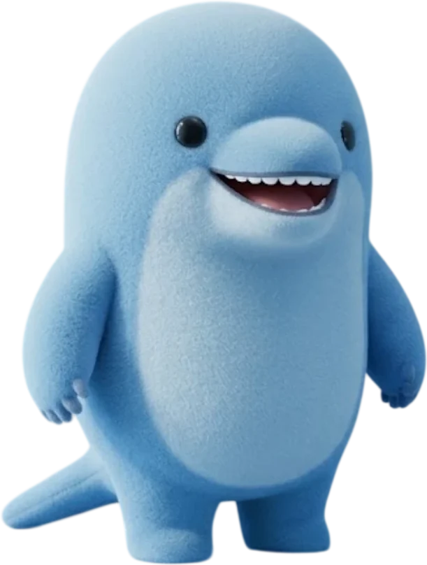
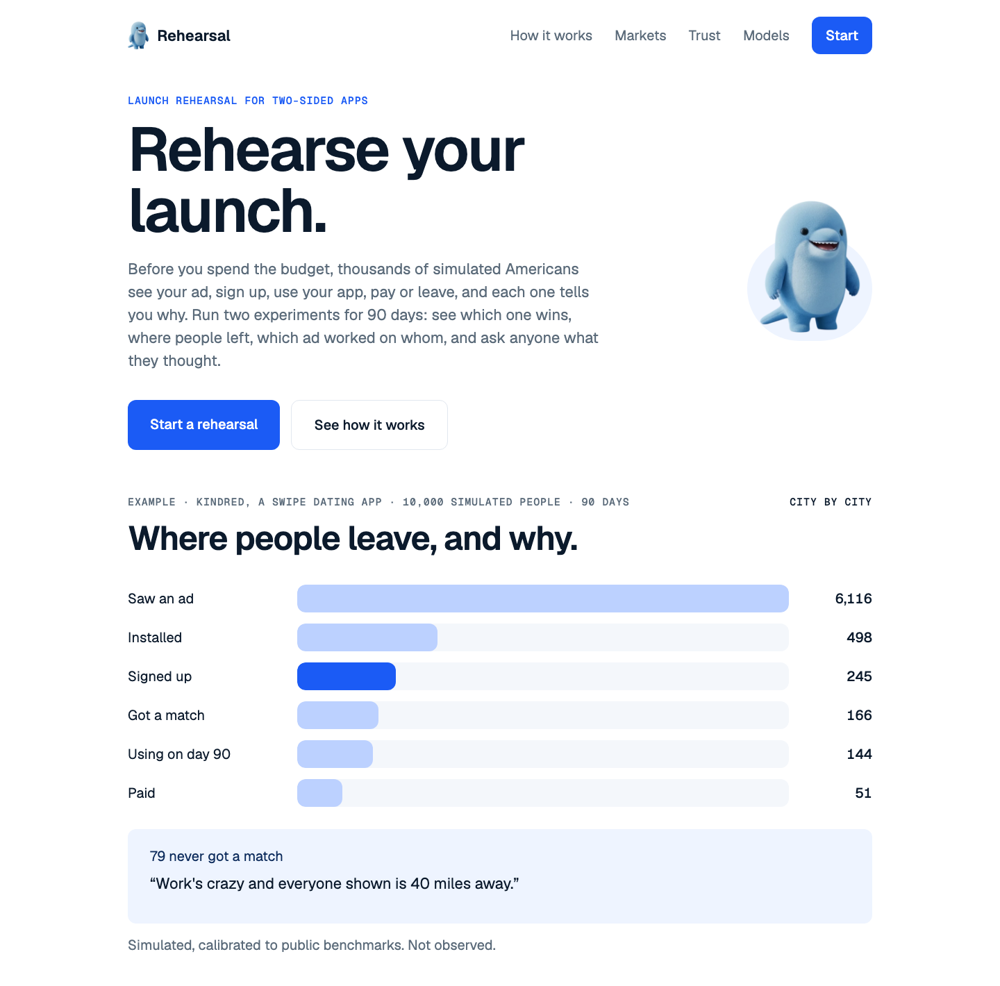
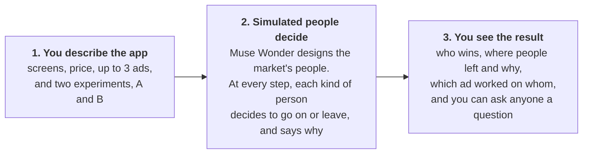
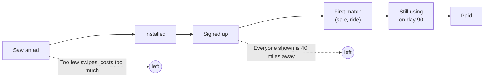
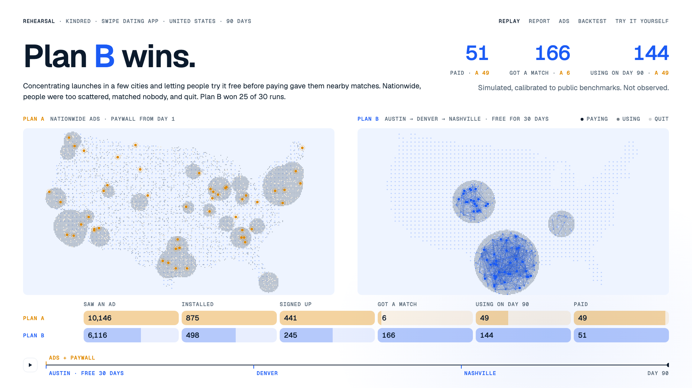
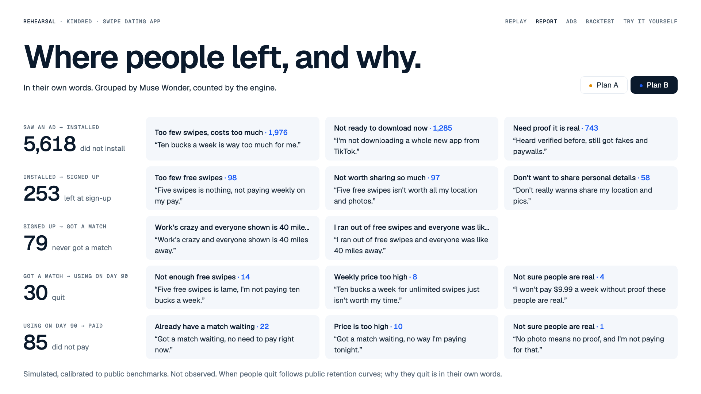
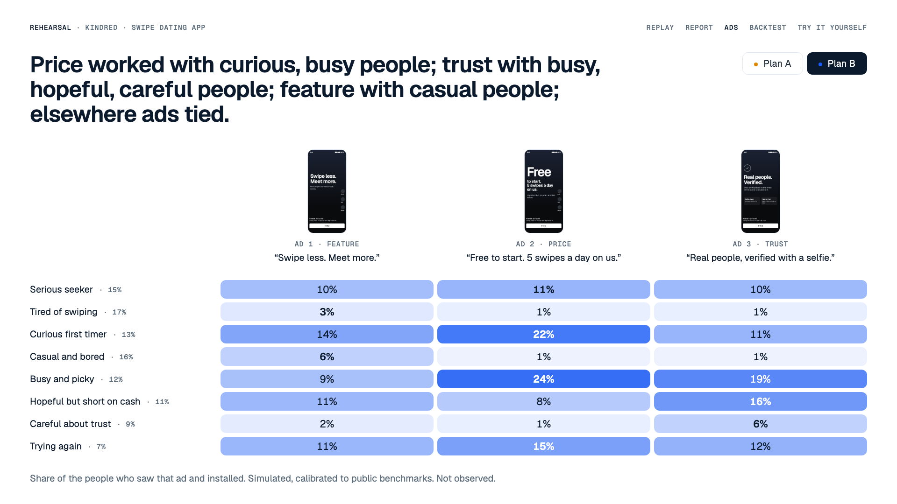
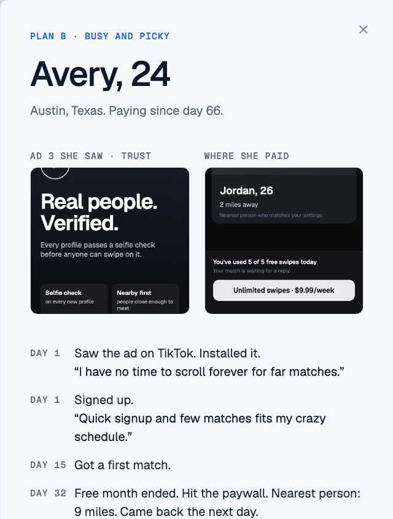
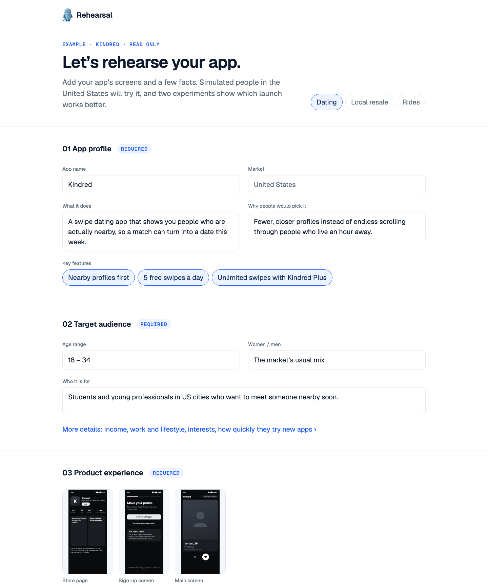
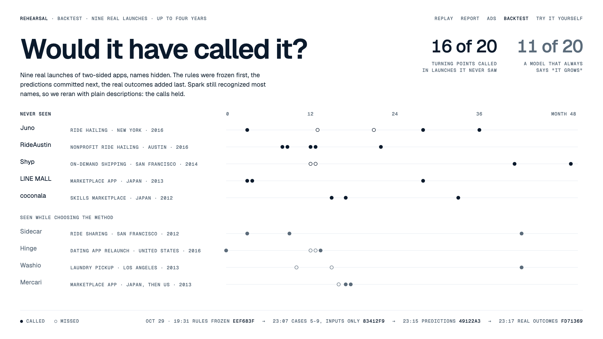

<div align="center">



# Rehearsal

**Rehearse your app's launch before you spend the budget.**

Thousands of simulated Americans see your ad, install, sign up, use your app, pay or leave over
90 days, and each one tells you why.

**[Open the live demo →](https://tokyosini573--rehearsal.modal.run)**

Built solo for the Meta Global AI Developer Hackathon (Indie track)<br>
with **Muse Wonder · Muse Spark · Muse Glimmer · Muse Voice Transcribe**

</div>

<br>



## In one sentence

**Rehearsal is a dress rehearsal for an app launch.** A theater runs the whole show once in front
of a test audience before opening night. Rehearsal does the same for a launch: you describe your
app and two ways to launch it, a simulated market lives through 90 days of each, and you see which
one works, where people dropped off, and why, in their own words.

## Why it matters

Some apps only work when two kinds of people are near each other: a dating app needs people to
date nearby, a resale app needs buyers near sellers, a ride app needs drivers near riders.
Until both sides are there, the app is empty, and how you launch decides whether they ever
meet.

- **You launch only once.** The same budget can bring twice the users or almost none,
  depending on where and how you spend it.
- **Testing for real is slow.** Trying a plan in the real market takes months and the whole budget.
- **Surveys miss the map.** People can say they like an app and still leave when nobody is nearby.

## How it works



1. **Describe your app and what to test.** A short brief: what the app does and who it's for, its
   screens (store page, sign-up, the main screen, the paywall), how it makes money, up to three
   ads, and two experiments. Each experiment lists only what it changes: where you launch, which
   channels, the price, a free trial.
2. **Simulated people decide.** Muse Wonder looks at your screens and designs 6 to 10 kinds of
   people for the market. Each person gets their own age, job, town and mood. At every step they
   decide on the real screen image, and Muse Spark (or Glimmer, distilled from it) gives
   the decision and the reason. A world engine moves them day by day, calibrated to public
   industry benchmarks.
3. **See where people left, and ask why.** Both experiments run 30 times. You get the verdict,
   the funnel, the reasons, the ads comparison, and every single person's story.

<details>
<summary><b>The full funnel each person goes through</b></summary>

<br>



At every arrow, the people who stop say why in one sentence. Muse Wonder groups the sentences
into themes; the engine counts the people, so no number on screen comes from a language model.

</details>

## What you get

### 1. Which experiment wins, and why



The verdict comes first, in one plain sentence. Below it, both experiments play out on two US maps
over 90 days, with the funnel under each. In the Kindred example, nationwide ads (A) reach more
people, but they are too spread out to match anyone. Launching city by city with a free month (B)
wins 25 of 30 runs.

### 2. Where people left, and why



For each step of the funnel: how many people stopped there, and the top reasons in their own
words. *"Ten bucks a week is way too much for me."* *"Five free swipes isn't worth all my
location and photos."*

### 3. Which ad worked on whom



Up to three ads, compared across every kind of person. Here the price ad worked best on curious
first-timers and busy people, and the trust ad on people who are hopeful but short on cash.

### 4. Any one person, and ask them

<table>
<tr>
<td width="42%"></td>
<td>

Click any dot on the map to open that person: who they are, the ad they saw, the screen where
they paid or left, and what they did each day.

Then **ask them a question, by voice or by text.** Muse Voice Transcribe turns your question into
text, and Muse Spark answers as that person, using only their own record from the simulation.

> **Avery, 24, Austin.** Saw the trust ad on day 1: *"I have no time to scroll forever for far
> matches."* Got a first match on day 15, hit the paywall when the free month ended, and started
> paying on day 66.

</td>
</tr>
</table>

### And the input: the Setup page



Seven short sections about the app (profile, audience, product, money, ads, competition,
retention) and an eighth for the two experiments. Most inputs are choices or numbers. The public
site shows each example read-only; the live run with your own screens is for the admin, because
every run calls the models and costs money.

## Three markets, three answers

Each example is a made-up app with its own screens, people and two launch plans. The winner is
not always the same kind of plan.

| Market | Demo app | Experiment A | Experiment B | Result |
|---|---|---|---|---|
| Dating | **Kindred** | Nationwide TikTok ads, paywall from day 1 | Austin, then Denver and Nashville, campus ambassadors, 30 days free | **B** wins 25 of 30 runs |
| Resale | **Reloop** | Nationwide feed ads, everyone at once | Seattle then Portland, sellers first | **B** wins 30 of 30 runs: 1,837 sales against 0 |
| Rides | **Hopway** | Three cities at once, riders and drivers together | Austin then Denver, drivers first | **B** wins 22 of 30 runs: 387 rides against 321 |

Try each one: [Kindred](https://tokyosini573--rehearsal.modal.run/?replay=engine) ·
[Reloop](https://tokyosini573--rehearsal.modal.run/?replay=reloop) ·
[Hopway](https://tokyosini573--rehearsal.modal.run/?replay=hopway)

## Built on Meta's models

| Model | What it does in Rehearsal |
|---|---|
| **Muse Wonder** | Looks at the app's screens and both plans and designs the market's kinds of people. Names the themes in people's reasons, and writes the one-sentence verdict. |
| **Muse Spark** | Decides for each kind of person at every step, looking at the actual screen image, and says why. Answers live interview questions in character. |
| **Muse Glimmer** | Fine-tuned (QLoRA) to answer like Spark for each individual person in the dating demo: same top choice as Spark 85% of the time (Spark agrees with itself 86%), at 0.064 s instead of about 20 s per decision. [Weights are public](https://huggingface.co/Yesini/Rehearsal-Glimmer-30B-r1) (Apache 2.0). |
| **Muse Voice Transcribe** | Turns a spoken question to a simulated person into text. |

## Does it predict anything real?



A world model is only worth trusting if it can predict outcomes it has not seen. The same engine
was run on **9 real launches of two-sided apps**, with their names hidden, and asked yes/no
questions about their growth ("More trips in month 13 than in month 10?").

- **The order of the commits is the evidence.** On 2026-10-29 the rules were frozen first
  (`eef683f`), then the held-out cases were added as inputs only (`83412f9`), then the predictions
  were committed (`49122a3`), and only then the real outcomes (`fd71369`).
- **On the held-out cases it called 16 of 20 turning points**, against 11 of 20 for a model that
  always says "it grows" (Brier score 0.134 against 0.450).
- **It is not just memory.** Spark recognized most companies, so the backtest was rerun with
  plain descriptions. The predictions moved by 0.07 on average and 2 of 33 flipped.

Full report: [`backtest/report.md`](backtest/report.md).

## Honest limits

Every number on screen is a simulation, calibrated to public benchmarks; none is observed data.

- **Small check.** 20 held-out questions on 5 apps is a check of the method, not a measured accuracy.
- **Simulated people.** The people are Muse Wonder's judgment of each US market, not census data,
  and they carry the models' biases.
- **Missing forces.** The engine has no competitors and no price changes over time.
- **US and two-sided only.** The map, ad costs and backtest rules are for two-sided apps in the US.

The full list is in [`docs/method.md`](docs/method.md#limits).

## Under the hood

The whole method (the pipeline, the matching and churn math, calibration, the market packs, the
Spark-to-Glimmer distillation, the backtest and privacy) is in **[`docs/method.md`](docs/method.md)**.
Other docs:

- [`docs/brief-format.md`](docs/brief-format.md): what a founder puts in.
- [`docs/replay-format.md`](docs/replay-format.md): what the engine puts out and the site plays.
- [`docs/distillation.md`](docs/distillation.md): distilling Spark into Glimmer, with all tables.

**Privacy.** Every simulated person is fictional, and only fictional data was sent to the Spark
contributor model. Uploaded screens and visitor questions go to Spark standard, which is not used
for training. No code, data or design from any existing company's product is used.

## Run it yourself

```bash
python3 -m venv .venv && .venv/bin/pip install -r requirements.txt
.venv/bin/python -m engine.run --runs 30      # rehearse both plans -> web/public/replays/engine.json
.venv/bin/python -m pytest -q tests
cd web && npm install && npm run dev         # http://localhost:5173
```

A run needs no API key and no GPU, because the models' decisions are committed.

```bash
.venv/bin/python -m engine.run --plans plans/reloop.yaml --name reloop   # resale -> ?replay=reloop
.venv/bin/python -m engine.run --plans plans/hopway.yaml --name hopway   # rides  -> ?replay=hopway
```

The live interview, live runs and the steps that call the models need a Meta Model API key in
`.env` (see `.env.example`):

```bash
.venv/bin/python -m engine.serve              # interview and live-run API on :8787; the dev server proxies /api to it
.venv/bin/modal deploy engine/site_modal.py   # the public site (key in the Modal secret rehearsal-meta)
```

<details>
<summary><b>Every page of the site</b></summary>

<br>

| Open | What you see |
|---|---|
| [`/`](https://tokyosini573--rehearsal.modal.run) | The front page, ending with "Start a rehearsal". |
| [`/?new&replay=engine`](https://tokyosini573--rehearsal.modal.run/?new&replay=engine) | The Setup page, read-only for an example. Switch markets at the top. |
| [`/?new&admin`](https://tokyosini573--rehearsal.modal.run/?new&admin) | The admin's live run: upload your own screens and ads, run with Muse Wonder and Muse Spark. |
| [`/?play`](https://tokyosini573--rehearsal.modal.run/?play) | The main screen: both experiments on two US maps. |
| [`/?replay=engine&report`](https://tokyosini573--rehearsal.modal.run/?replay=engine&report) | Where people left, and why. |
| [`/?replay=engine&ads`](https://tokyosini573--rehearsal.modal.run/?replay=engine&ads) | Which kinds of people answered which ad. |
| [`/?day=90&person=b:42`](https://tokyosini573--rehearsal.modal.run/?day=90&person=b:42) | One person's drawer; ask them a question. |
| [`/?backtest`](https://tokyosini573--rehearsal.modal.run/?backtest) | The backtest on 9 real launches. |

</details>

<details>
<summary><b>Repository layout</b></summary>

<br>

```
engine/world/     the world: people (Wonder), decisions (Glimmer, Spark), channels, simulation, calibration, report, replay
engine/packs/     market packs: dating, resale, rides
engine/live.py    the admin's live run from a brief and its images
engine/distill/   Spark -> Glimmer: data, QLoRA training, evaluation, vLLM serving on Modal
engine/backtest/  backtest runner and scoring
engine/screens/   the demo apps' screens (HTML rendered to images the models look at)
engine/interview.py, serve.py, site_modal.py   live interview API and the public site
plans/            each market's two launch plans, its brief (<app>.brief.yaml), channel costs, benchmark research
rules/            frozen two-sided launch rules and their evidence
backtest/         cases (inputs), predictions, answers, report
data/             Wonder's people, the models' decisions, distillation results
web/              the site (Vite, React, Tailwind); replays in web/public/replays
docs/             method, brief format, replay format, distillation
```

</details>

## Credits and licenses

- **Map:** `us-atlas` (ISC), from US Census Bureau boundaries. **Fonts:** Geist and Geist Mono (SIL OFL).
- **The dolphin** was made by the author with an AI image tool for this project.
- **Demo apps:** Kindred, Reloop and Hopway are made up for this demo; their screens are in
  `engine/screens/`.
- **MiroFish** (AGPL-3.0) was design inspiration only, and none of its code is used.
