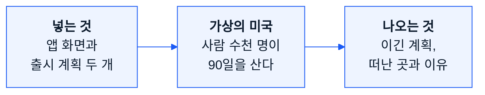
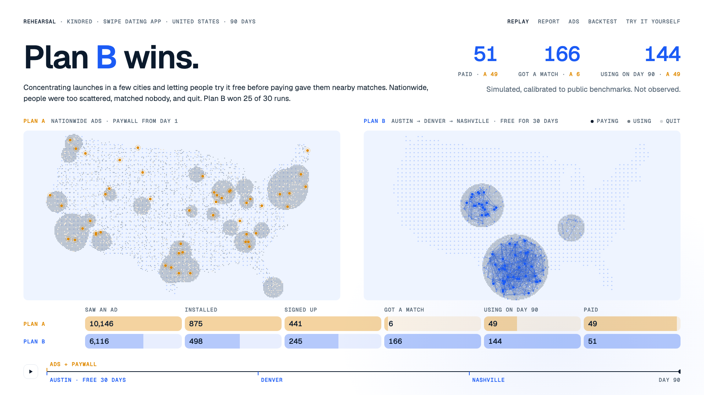
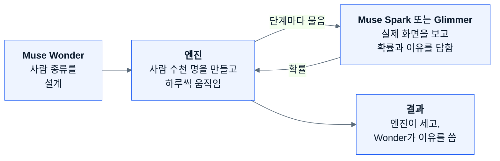
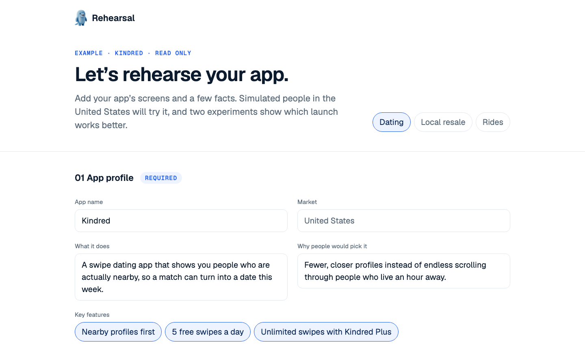
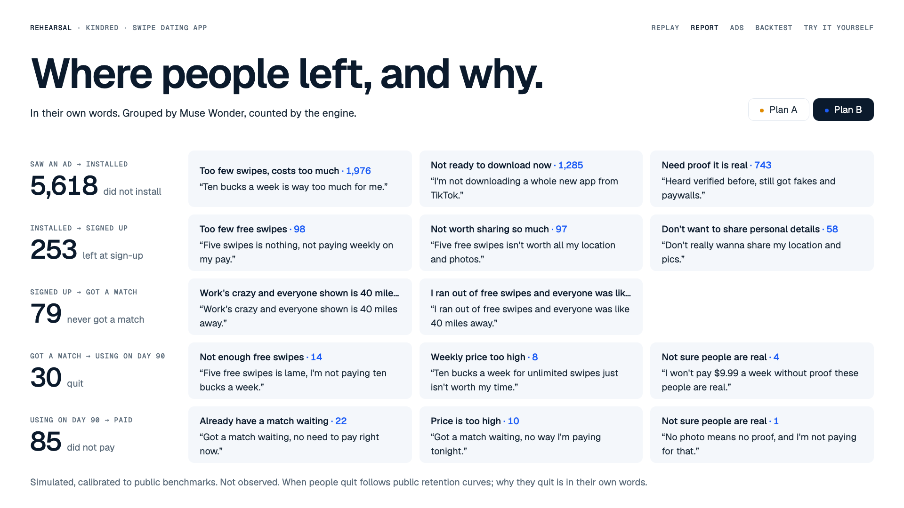
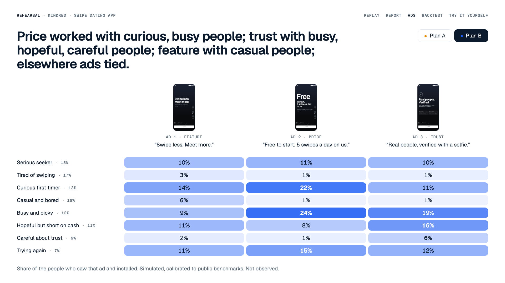
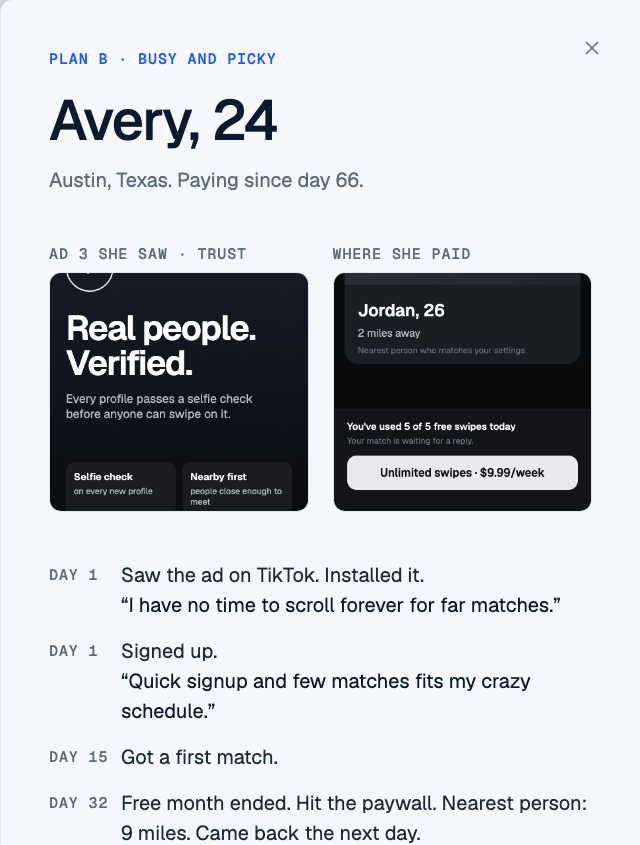
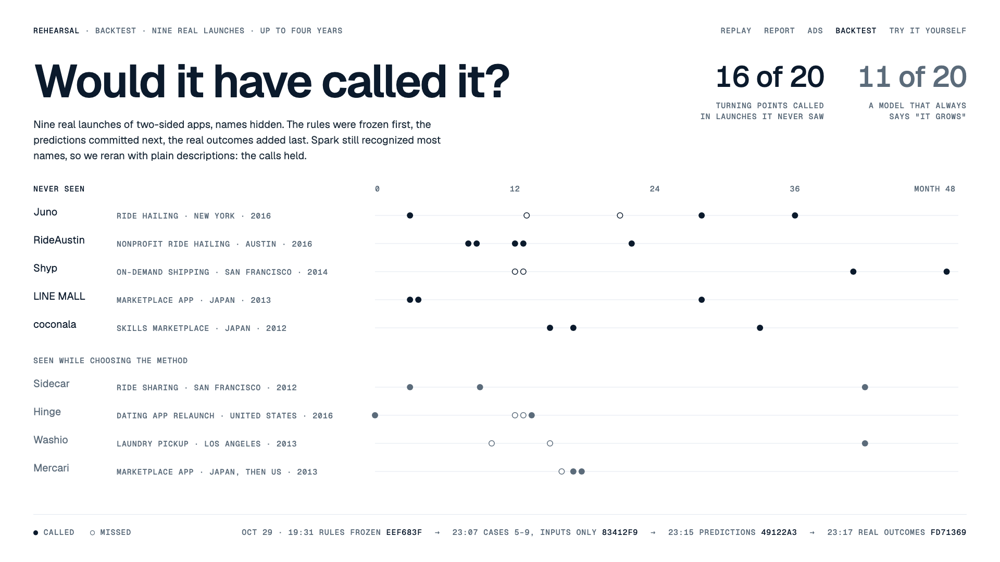
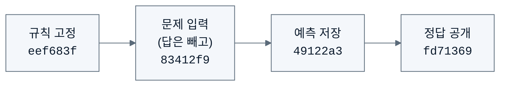
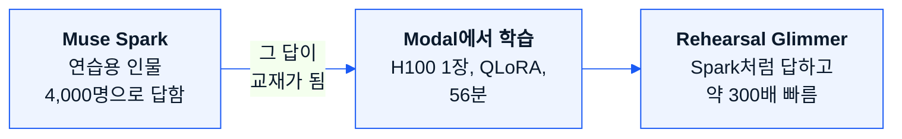

# Rehearsal 핸드북

처음 읽는 사람을 위한 쉬운 설명이에요. 2026-11-10에 마지막으로 고쳤어요.

## 한 문장으로

**앱을 진짜로 내놓기 전에, 가상의 미국에서 두 가지 방법으로 먼저 내놓아 보고 어느 쪽이 나은지,
왜 그런지 알려 주는 프로그램이에요.**

이름이 Rehearsal(리허설)인 이유예요. 배우가 무대에 오르기 전에 리허설을 하듯, 앱도 출시하기 전에
리허설을 해 보자는 거예요.

## 어떤 앱에 쓰나요?

Rehearsal은 **양면 시장 앱**을 위한 도구예요. 두 무리의 사람이 서로를 찾아야 쓸모가 생기는 앱이에요.

| 앱 | 두 무리 |
|---|---|
| 데이팅 | 만날 사람을 찾는 사람들 |
| 중고 거래 | 파는 사람, 사는 사람 |
| 차량 호출 | 기사, 승객 |

이런 앱은 종류가 달라도 출시할 때 같은 법칙을 따라요. **근처에 상대편이 충분히 모이기 전까지는
아무도 남지 않는다**는 법칙이에요. Rehearsal은 이 법칙을 계산해요. 아래 데이팅 앱은 예시 하나일 뿐,
데이팅 앱 전용이 아니에요.

## 예를 들어 볼게요

지어낸 데이팅 앱 **Kindred**를 예산 4만 달러로 미국에 내놓는다고 해 봐요. 방법은 두 가지예요.

- **계획 A:** 미국 전체에 광고하고, 첫날부터 돈을 받는다.
- **계획 B:** 도시 세 곳에 차례로 열고, 처음 30일은 무료로 둔다.

가상 시장에서 두 계획을 30번씩 돌려 봤더니 **B가 30번 중 25번 이겼어요.**

이유는 간단해요. 데이팅 앱은 **근처에 만날 사람이 있어야** 쓸모가 있어요. A는 사람을 더 많이 모았지만
다들 멀리 흩어져 있어서 매칭이 거의 안 됐어요(첫 매치 1~6명). B는 사람을 몇 도시에 모았기 때문에 서로
만날 수 있었어요(첫 매치 159~186명).

## 어떻게 돌아가나요?

네 부분이 함께 일해요. 영화 촬영에 비유하면, 배역을 짜는 사람, 연기하는 사람, 시간을 재고 세는 사람,
결과를 설명하는 사람이 따로 있는 셈이에요.

1. **Muse Wonder가 사람을 설계해요.** 앱 화면과 두 계획을 보고, 이 출시가 어떤 종류의 사람에게 닿을지
   정해요(Kindred는 8종류: 나이, 직업, 형편, 기분).
2. **엔진이 사람들을 만들어요.** 그 종류에서 가상의 미국인 수천 명을 뽑아 미국 지도 위에 놓아요.
3. **AI가 그 사람이 되어 판단해요.** 단계마다(설치할까? 가입할까? 돈을 낼까?) AI에게 "당신은 34살
   교사이고, 근처에 아직 아무도 없어요"라고 알려 주고, 그 사람이 볼 **실제 화면**을 보여 줘요.
   AI는 확률("설치 30%, 넘김 70%")과 이유 한 문장으로 답해요.
4. **엔진이 주사위를 굴리고 세요.** AI는 확률만 말해요. 엔진이 그 확률로 사람마다 결정을 내리고 모두를
   세요. **화면의 숫자는 하나도 AI가 지어낸 게 아니에요.**
5. **Wonder가 설명해요.** 일어난 일과 사람들이 한 말을 읽고, 결과 아래에 이유 한 문장을 써요.

화면은 상황에 따라 바뀌어요. 데이팅 앱이라면 근처에 사람이 많을 때는 "2마일 거리"를, 없을 때는
"41마일 거리"를 보여 줘요. 그래서 같은 사람이라도 계획 B에서는 남고 계획 A에서는 떠나요. 두 계획의
차이는 이렇게 만들어져요.

### Spark일까, Glimmer일까?

| | **Muse Spark** | **Muse Glimmer** (직접 학습시킨 모델) |
|---|---|---|
| 묻는 단위 | 사람 종류와 상황마다 한 번(3번 물어 평균) | 한 사람 한 사람 모두 |
| 쓰는 곳 | Reloop, Hopway, 모든 실시간 실행 | Kindred(2,928명) |
| 시간 | 몇 분 | GPU 1장으로 약 1시간 |
| 이유 | 빠르고, 처음 보는 앱에도 바로 쓸 수 있어요 | 사람마다 답이 다 달라요 |

Glimmer는 데이팅 화면만 배웠어요. 그래서 중고 거래나 차량 호출 앱에 쓰려면 새로 학습시켜야 해요.

### Wonder는 언제 사람을 설계하나요?

- **예시 세 개:** 미리 한 번 설계해서 파일로 저장해 뒀어요. 그래서 예시를 보는 데는 돈이 들지 않아요.
- **실시간 실행:** 실행 버튼을 누르는 그 순간에, 올린 화면을 보고 설계해요.

## 사용 설명서: 화면을 따라가 보기

### 1단계 · 앱과 두 실험을 넣는다

- **앱 정보 7칸:** 앱 소개, 누구를 위한 앱인지, 화면, 돈 버는 방법(가격, 결제 화면이 나오는 때),
  광고 최대 3개, 경쟁 앱, 다시 오게 만드는 것. 가상 인물들은 올린 화면 이미지를 직접 보고 판단해요.
- **실험 설정 1칸:** 사람 수(1,000·5,000·10,000명), 기간(7·14·30·90일), 그리고 계획 A와 B가 각각
  무엇을 바꾸는지(지역, 광고 채널, 예산, 가격, 무료 기간, 보여 줄 광고).
- 대부분 고르거나 숫자를 넣는 칸이에요.

공개 사이트는 예시 세 개를 읽기 전용으로 보여 줘요. 관리자 키 없이 **Run both experiments**를 누르면
문의 주소가 나와요. 실시간 실행은 돌릴 때마다 AI를 불러서 돈이 들기 때문이에요.

### 2단계 · 누가 이겼는지 본다

맨 위 한 줄이 답이고, 그 아래 한 문장이 이유예요. 그 아래에 숫자 세 개 이하, 지도 두 개(A 주황,
B 파랑), 그리고 깔때기가 있어요. 광고를 봄 → 설치 → 가입 → 첫 매치 → 90일째 사용 → 결제로 갈수록
줄어요. 재생 버튼을 누르면 90일이 30초 동안 펼쳐져요.

### 3단계 · 어디서 왜 떠났는지 본다

단계마다 몇 명이 멈췄는지, 그 사람들이 자기 말로 한 이유를 보여 줘요. 예를 들면 *"일주일에 10달러는
너무 비싸요."* 같은 말이에요. 말은 Muse Wonder가 주제 세 개까지로 묶고, 사람 수는 엔진이 세요.

### 4단계 · 어떤 광고가 누구에게 통했는지 본다

광고 세 개(기능, 가격, 신뢰)와 사람 종류를 맞대어, 그 광고를 본 사람 중 설치한 비율을 보여 줘요.
진할수록 잘 통한 거예요. Kindred 예시에서는 가격 광고가 호기심 많고 바쁜 사람에게, 신뢰 광고가
조심스러운 사람에게, 기능 광고가 가볍게 쓰는 사람에게 잘 통했어요.

### 5단계 · 한 사람에게 묻는다

지도에서 점 하나를 누르면 그 사람이 누구인지, 본 광고, 돈을 내거나 떠난 화면, 날짜별 기록이 나와요.
그리고 **말이나 글로 직접 물어볼 수 있어요.** Muse Voice Transcribe가 말을 글로 받아쓰고, Muse Spark가
그 사람의 기록만 가지고 그 사람으로서 대답해요.

### 6단계 · 믿을 만한지 확인한다

미래는 아직 모르니까, **결과가 이미 나온 과거의 앱**으로 시험했어요. 실제 양면 시장 앱 9개(차량 호출,
세탁 배달, 중고 거래 등)의 이름을 지우고 넣은 뒤, "10개월째보다 13개월째에 이용이 늘었을까?" 같은
질문에 답하게 했어요.

중요한 건 **순서**예요. 정답을 보고 나서 예측을 고치면 반칙이니까, 단계마다 git에 먼저 기록했어요.

처음 보는 앱 5개에서 전환점 20개 중 **16개**를 맞혔어요. "무조건 성장한다"고 찍으면 11개예요.
문제가 20개뿐이라 "정확도 80%"라고 장담하지는 않아요.

## 지금 바꿔 볼 수 있는 것

| 바꿀 수 있는 것 | 예 | 지금 |
|---|---|---|
| 출시 지역 | 전국, 또는 도시 몇 곳을 차례로 | 가능 (미국 26개 도시) |
| 광고 채널 | 아래 다섯 가지 | 가능 |
| 예산 | 실험마다 다르게 | 가능 |
| 가격, 무료 기간 | 주 $9.99, 30일 무료 | 가능 |
| 광고 | 최대 3개, 각각 이미지와 문구 | 가능 |
| 사람 수, 기간 | 1,000·5,000·10,000명, 7·14·30·90일 | 가능 |
| 90일보다 긴 기간, 세 번째 실험 | | 안 함 |
| 미국 밖 시장, 한쪽만 있는 앱 | | 안 함 |

### 사람이 앱을 처음 만나는 다섯 가지 방식

광고 채널을 브랜드가 아니라 **사람이 앱을 처음 만나는 방식**으로 나눠요. 인스타그램과 틱톡은 만나는
방식이 같아서 한 칸이고, 다른 건 비용뿐이에요. 비용 숫자는 출처가 있는 업계 기준값이에요.

| 방식 | 예 | 특징 |
|---|---|---|
| 온라인 피드 광고 | 틱톡, 인스타그램, 유튜브, 배너 | 넓게 닿고 싸지만, 지나가다 본 광고라 관심이 낮아요 |
| 검색·스토어 광고 | 구글 검색, 앱스토어 검색 | 이미 찾던 사람이라 설치를 잘 하지만, 비싸고 찾는 사람 수만큼만 닿아요 |
| 오프라인 현장 홍보 | 캠퍼스 홍보, 부스, 전단지 | 그 도시에만 닿고, 사람이 직접 보여 줘서 설치를 잘 해요 |
| 옥외·대중매체 | 지하철, 버스, 옥외 광고판, TV | 한 지역에 아주 넓게 닿지만, 바로 누를 수 없어 설치는 드물어요 |
| 친구 초대 | 초대 보상 | 쓰던 사람이 근처 친구를 데려와요. 성공할 때마다 보상 비용이 들어요 |

### 시장 팩 세 가지

양면 시장 앱은 엔진(근처에 누가 있는지, 매칭, 입소문, 이탈)을 함께 쓰지만, 사람이 결정하는 순간은
앱마다 달라요. 이 차이를 담은 묶음을 **시장 팩**이라고 불러요.

| 팩 | 두 무리 | 결정하는 순간 | 예시 결과 |
|---|---|---|---|
| 데이팅 (**Kindred**) | 만날 사람을 찾는 사람들 | 설치할까 → 결제 화면에서 돈을 낼까 | B가 30번 중 25번 |
| 중고 거래 (**Reloop**) | 파는 사람, 사는 사람 | 설치할까 → 물건을 올릴까 / 이 물건을 살까 | B가 30번 중 30번: 판매 1,837건 대 0건 |
| 차량 호출 (**Hopway**) | 기사, 승객 | 설치할까 → 지금 운행을 켤까 / 이 가격에 부를까 | B가 30번 중 22번: 운행 387건 대 321건 |

Hopway는 기사를 먼저 모은 쪽이 승객 근처에 차를 남겨서 이겼어요. 차량 호출 예시는 첫 탑승 비율이
목표(30%)에 못 미치는 약 10%라서, 절대 숫자보다 두 계획의 비교로 봐 주세요.

## 왜 AI를 하나 더 가르쳤나요?

Spark는 사람 흉내를 잘 내지만 한 번 답하는 데 20초쯤 걸려요. 가상 인물 수천 명의 판단을 모두
Spark에게 물으면 너무 오래 걸려요. 그래서 공개 모델 Glimmer에게 Spark의 답을 보여 주고 똑같이 답하도록
가르쳤어요. 이걸 **증류**라고 해요.

- 처음 보는 문제에서 Glimmer는 Spark와 **85%** 같은 답을 골랐어요. Spark에게 같은 문제를 두 번 물어도
  86%만 같으니, 거의 Spark만큼 하는 셈이에요.
- 한 번 답하는 데 20초가 아니라 **0.064초**가 걸려요.
- Kindred의 2,928명이 마주칠 수 있는 모든 상황에 답했어요. 61,488개를 GPU 1장으로 약 1시간 만에 끝냈어요.

Glimmer는 가상의 데이팅 앱 하나만 배운 모델이라 범용 도구는 아니에요. 대신 방법을 보여 줘요.
공개 모델을 받아서, GPU로 한 가지 일에 맞게 학습시키고, 가중치를 공개하는 방법이에요.
**가중치는 Hugging Face에 Apache 2.0으로 공개돼 있어요:
[Yesini/Rehearsal-Glimmer-30B-r1](https://huggingface.co/Yesini/Rehearsal-Glimmer-30B-r1).** 자세한 방법과
표는 [`distillation.md`](distillation.md)에 있어요(영어).

## 아직 못 하는 것

- 경쟁 앱이 없어요. 실제로는 경쟁자가 나타나면 판이 바뀌어요.
- 가상 인물은 AI가 설계한 사람들이라, 실제 인구 통계와 같지 않고 AI의 편향도 담겨 있어요.
- 가격이나 광고를 중간에 바꾸는 상황은 아직 다루지 못해요.
- 미국 밖 시장과, 한쪽 사람만 있는 앱은 다루지 않아요.
- Spark로 돌리면 같은 종류, 같은 상황의 사람은 같은 이유를 말해요.

## 지금 어디까지 왔나요?

| | 상태 |
|---|---|
| 월드 엔진, 시장 팩 세 가지, 채널 다섯 가지 | 완료 |
| 사이트: 첫 페이지, 입력, 결과 화면 다섯 개 | 완료 |
| [공개 사이트](https://tokyosini573--rehearsal.modal.run) | 운영 중, 방문자가 오면 그때 켜져요 |
| 올린 화면으로 하는 실시간 실행 | 요청 시 (실행 버튼이 문의 주소를 보여 줘요) |
| [Glimmer 가중치](https://huggingface.co/Yesini/Rehearsal-Glimmer-30B-r1) | 공개 |
| Meta Global AI Developer Hackathon 출품 | 2026-11-04 제출 |

## 무엇이 어디서 돌아가나요?

| 층 | 무엇 | 역할 |
|---|---|---|
| AI 모델 | Muse Wonder, Spark, Glimmer, Voice Transcribe (Meta API) | 사람 설계, 판단과 이유, 한 사람씩 답하기, 음성 받아쓰기 |
| 월드 엔진 | Python (`engine/`) | 미국 지도, 90일 시계, 시장 팩, 채널, 30번 반복 |
| 학습 | Modal GPU, QLoRA | Spark → Glimmer 증류, 가중치는 Hugging Face로 |
| 웹사이트 | React, Vite, Tailwind (`web/`) | 첫 페이지, 입력, 재생, 리포트, 광고, 인터뷰 |
| 서버 | Modal, FastAPI 컨테이너 1대 | 사이트와 미리 계산한 결과 제공, 인터뷰 API, 데이터베이스 없음 |

## 더 보고 싶다면

- **직접 해 보기:** [사이트](https://tokyosini573--rehearsal.modal.run)를 열고 지도에서 점 하나를 누르면,
  그 사람에게 물어볼 수 있어요.
- **프로젝트 소개:** [README](../README.md) (영어)
- **방법 전체:** [`method.md`](method.md) (영어)
