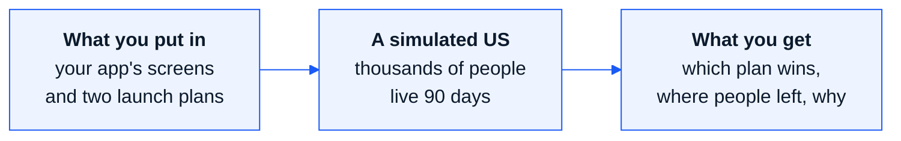
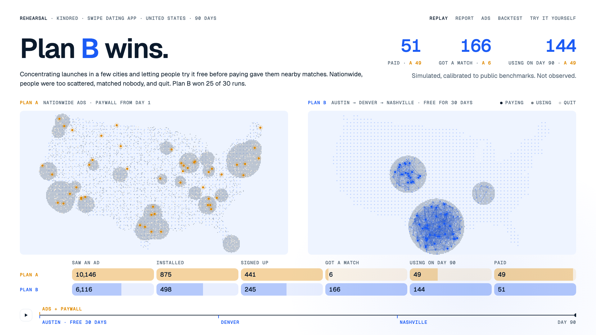
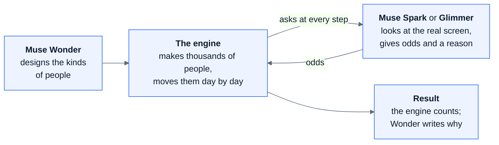
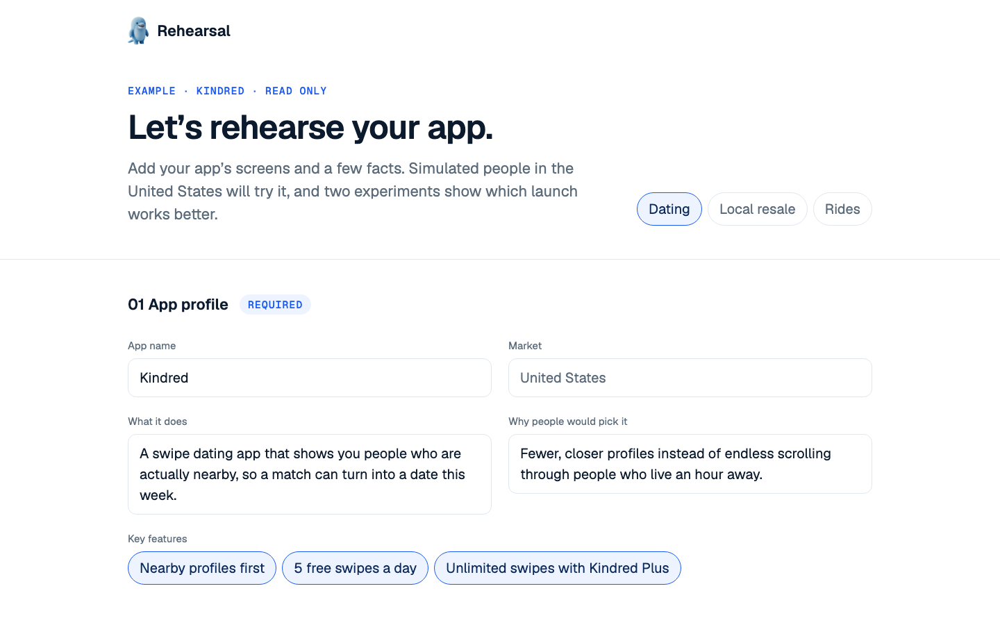
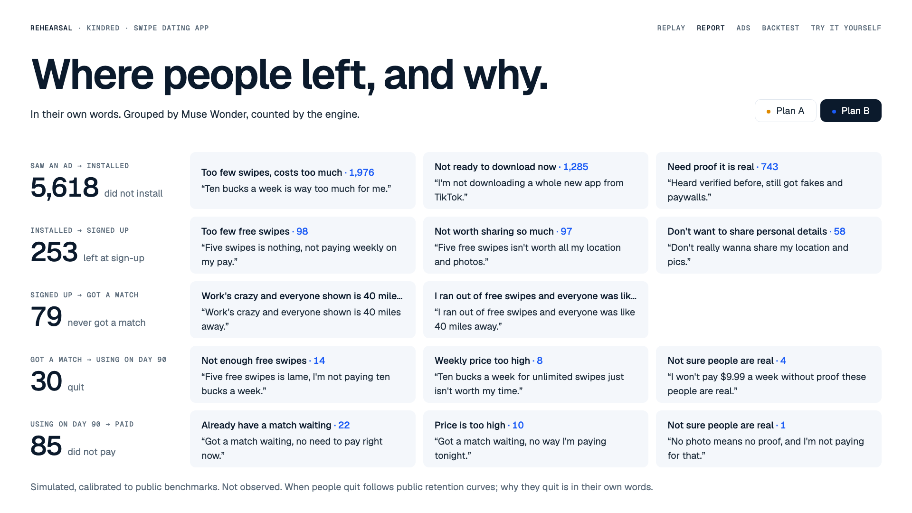
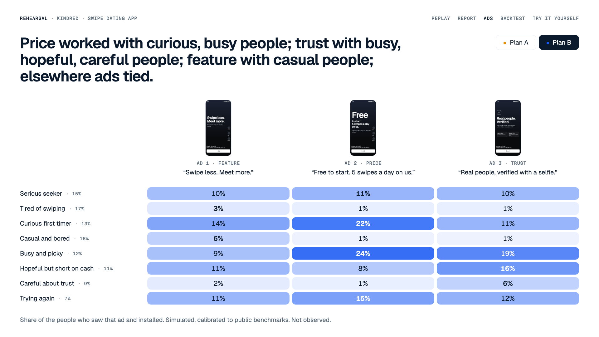
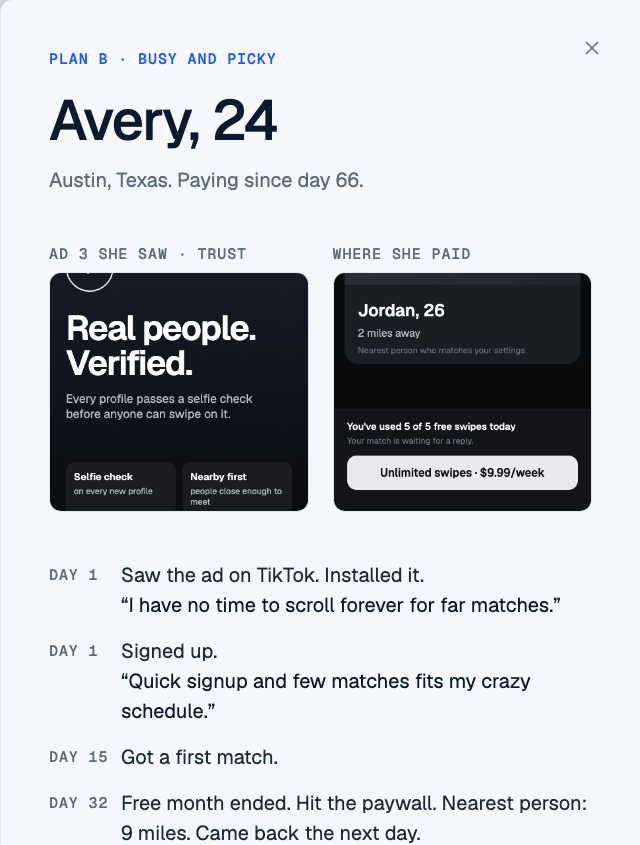
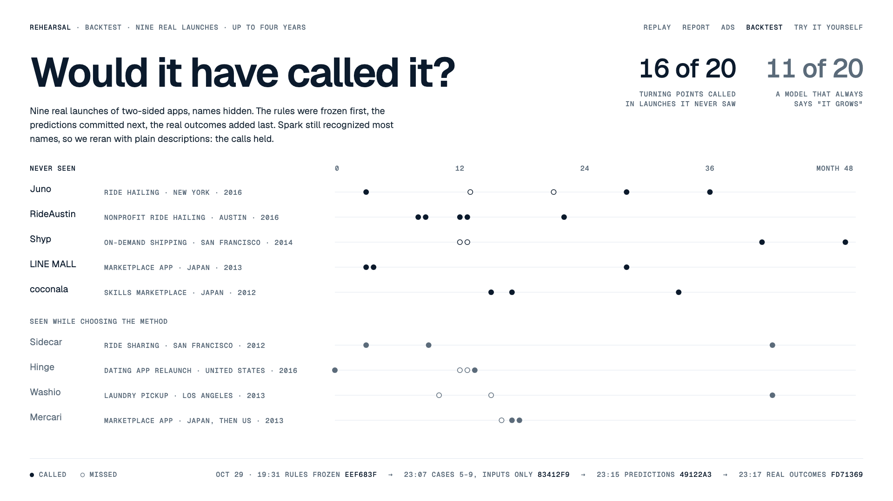
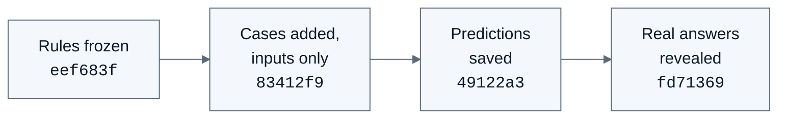
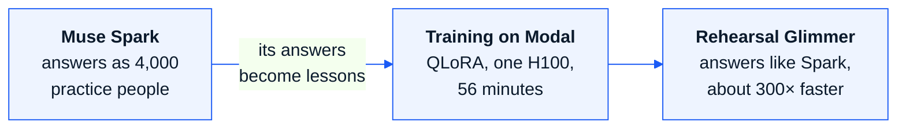

# Rehearsal handbook

A plain-words guide for first-time readers. Updated 2026-11-10.

## In one sentence

**Before you launch an app for real, Rehearsal launches it two ways in a simulated United States and
tells you which way works better, and why.**

That is where the name comes from. Actors rehearse before opening night; an app can rehearse its launch.

## Which apps is it for?

Rehearsal is for **two-sided apps**: apps that are only useful when two groups of people find each other.

| App | The two sides |
|---|---|
| Dating | people looking for a date |
| Resale | sellers and buyers |
| Rides | drivers and riders |

These apps look different, but their launches follow one law: **nobody stays until enough of the other
side is nearby.** Rehearsal computes that law. The dating app below is one example, not the whole tool.

## An example

Say you launch **Kindred**, a made-up dating app, in the US with a $40,000 budget. Two plans:

- **Plan A:** ads across the whole country, and people pay from day one.
- **Plan B:** open in three cities one after another, free for the first 30 days.

Both plans were played 30 times in the simulated market. **Plan B won 25 of 30.**

The reason is simple. A dating app is only useful when **someone to meet is nearby**. Plan A reached
more people, but they were spread too thin to match anyone (1 to 6 first matches). Plan B gathered
people in a few cities, so they could meet (159 to 186 first matches).

## How it works

Four parts work together. Think of a film shoot: one plans the cast, one plays the roles, one keeps the
clock and counts, and one explains the result.

1. **Muse Wonder designs the people.** It looks at your screens and both plans and decides what kinds of
   people the launch could reach (for Kindred, 8 kinds: their age, work, money and mood).
2. **The engine makes the crowd.** It draws thousands of fictional Americans from those kinds and places
   them on a US map.
3. **A model decides as each person.** At every step (install? sign up? pay?) the model is told "You are
   34, you work as a teacher, nobody is nearby yet" and is shown the **actual screen** that person would
   see. It answers with odds ("install 30%, skip 70%") and one sentence of why.
4. **The engine rolls the dice and counts.** The model only gives odds; the engine decides each person's
   move with those odds and counts everyone. **No number on screen is written by a language model.**
5. **Wonder explains.** It reads what happened and what people said, and writes the one-sentence reason
   under the verdict.

The screen changes with the situation. A dating app shows "2 miles away" when people are nearby and
"41 miles away" when they are not. The same person may stay in Plan B and leave in Plan A: that is how the
difference between plans is made.

### Spark or Glimmer?

| | **Muse Spark** | **Muse Glimmer** (fine-tuned) |
|---|---|---|
| Asks | once per kind of person and situation, 3 times, averaged | every single person, one by one |
| Used for | Reloop, Hopway, and every live run | Kindred (2,928 people) |
| Time | a few minutes | about an hour on one GPU |
| Why | fast, and works on any new app | each person answers differently |

Glimmer only learned dating screens, so it cannot answer for a resale or rides app without new training.

### When does Wonder design the people?

- **The three examples:** once, ahead of time. The designs are saved as files, so watching an example
  costs nothing.
- **A live run:** the moment you press run, from the screens you uploaded.

## A guide to the screens

### 1. Put in the app and two experiments

- **Seven short sections about the app:** profile, audience, product screens, money (price, when the
  paywall shows), up to three ads, competition, what brings people back. The simulated people look at
  the images you upload.
- **One section for the experiments:** how many people (1,000, 5,000 or 10,000), how long (7, 14, 30 or
  90 days), and what Plan A and Plan B change: cities, ad channels, budget, price, free days, which ads.
- Almost every input is a choice or a number.

The public site shows the three examples read-only. Pressing **Run both experiments** without the admin
key shows a contact address, because every live run calls the models and costs money.

### 2. See who won

The top line is the answer, with one sentence of why. Below it: at most three numbers, the two maps
(Plan A amber, Plan B blue), and the funnel: saw an ad → installed → signed up → first match → still
using on day 90 → paid. Press play and 90 days run in 30 seconds.

### 3. See where people left, and why

For every step: how many people stopped there, and their reasons in their own words, such as *"Ten
bucks a week is way too much for me."* Muse Wonder groups the sentences into up to three themes; the
engine counts the people.

### 4. See which ad worked on whom

Three ads (feature, price, trust) against every kind of person: the share who installed after seeing
each. Darker means it worked better. In the Kindred example the price ad worked best on curious and busy
people, the trust ad on careful ones, and the feature ad on casual ones.

### 5. Ask one person

Click any dot on the map. You see who they are, the ad they saw, the screen where they paid or left, and
what they did each day. Then **ask them a question by voice or text**: Muse Voice Transcribe turns speech
into text, and Muse Spark answers as that person, from their own record.

### 6. Check whether it can be trusted

The future is unknown, so Rehearsal was tested on **past launches whose outcomes are known**: 9 real
two-sided apps (rides, laundry delivery, resale and others) with their names hidden, asked questions like
"More trips in month 13 than in month 10?"

What matters is **the order**. Changing a prediction after seeing the answer would be cheating, so each
step was committed to git before the next:

On 5 apps it had never seen, it called **16 of 20** turning points. Always guessing "it grows" calls 11.
With only 20 questions, this is a check of the method, not a promise of 80% accuracy.

## What you can change

| What | Example | Now |
|---|---|---|
| Where to launch | the whole country, or a few cities one after another | yes (26 US cities) |
| Ad channels | see the five below | yes |
| Budget | different per experiment | yes |
| Price, free days | $9.99 a week, 30 days free | yes |
| Ads | up to 3, each an image and a line | yes |
| People, days | 1,000 / 5,000 / 10,000; 7 / 14 / 30 / 90 days | yes |
| Longer than 90 days, a third experiment | | no |
| Markets outside the US, one-sided apps | | no |

### Five ways people first meet an app

Channels are grouped by **how a person meets the app**, not by brand. Instagram and TikTok meet people
the same way; only their costs differ. Every cost comes from a cited industry benchmark.

| Channel | Examples | What it is like |
|---|---|---|
| Online feed ads | TikTok, Instagram, YouTube, banners | wide and cheap, but people are only scrolling past |
| Search and app store ads | Google search, App Store search | people already looking, so they install; costly, and capped by searches |
| Offline promotion | campus ambassadors, booths, flyers | one city only; a person shows the app, so many install |
| Outdoor and mass media | subway, buses, billboards, TV | very wide in one area, but nobody can tap a poster |
| Friend referrals | invite rewards | users bring nearby friends; each success costs a reward |

### Three market packs

Two-sided apps share the engine (who is nearby, matching, word of mouth, leaving) but differ in the moment
people decide. A **market pack** holds that difference.

| Pack | Two sides | The moment people decide | Example result |
|---|---|---|---|
| Dating (**Kindred**) | people dating | install → pay at the paywall | B wins 25 of 30 |
| Resale (**Reloop**) | sellers, buyers | install → list an item / buy this item | B wins 30 of 30: 1,837 sales against 0 |
| Rides (**Hopway**) | drivers, riders | install → go online now / request at this price | B wins 22 of 30: 387 rides against 321 |

In Hopway, gathering drivers first left cars near riders. The rides example reaches only about 10% first
rides against a 30% target, so read it as a comparison of two plans, not as absolute numbers.

## Why train another AI?

Spark acts like a person well, but one answer takes about 20 seconds. Asking Spark for every decision of
thousands of people takes too long. So Glimmer, an open-weight model, was shown Spark's answers and taught
to answer the same way. This is called **distillation**.

- On questions it had not seen, Glimmer picked the same top answer as Spark **85%** of the time. Spark
  asked the same question twice agrees with itself 86%, so Glimmer is nearly as good as Spark.
- One answer takes **0.064 s** instead of about 20 s.
- Glimmer answered every situation the 2,928 Kindred people could meet: 61,488 answers in about an hour
  on one GPU.

Glimmer only learned one fictional dating app, so it is a learning project, not a general tool. What it
shows is the method: take an open-weight model, fine-tune it on a GPU for one narrow job, and publish the
weights. **The weights are public on Hugging Face under Apache 2.0:
[Yesini/Rehearsal-Glimmer-30B-r1](https://huggingface.co/Yesini/Rehearsal-Glimmer-30B-r1).** The full
method and tables are in [`distillation.md`](distillation.md).

## What it cannot do yet

- There are no competitors. In real life a rival can change everything.
- The people are designed by an AI. They are not census data, and they carry the models' biases.
- Prices and ads cannot change partway through a run.
- No markets outside the US, and no one-sided apps.
- With Spark, people of the same kind in the same situation give the same reason.

## Where it is now

| | Status |
|---|---|
| World engine, three market packs, five channels | done |
| Site: front page, setup, five result screens | done |
| [Public site](https://tokyosini573--rehearsal.modal.run) | running; starts when someone visits |
| Live runs from uploaded screens | on request (the run button shows a contact address) |
| [Glimmer weights](https://huggingface.co/Yesini/Rehearsal-Glimmer-30B-r1) | public |
| Meta Global AI Developer Hackathon entry | submitted 2026-11-04 |

## What runs where

| Layer | What | Job |
|---|---|---|
| AI models | Muse Wonder, Spark, Glimmer, Voice Transcribe (Meta API) | design people, decide and explain, per-person answers, speech to text |
| World engine | Python (`engine/`) | the US map, the 90-day clock, market packs, channels, 30 runs |
| Training | Modal GPU, QLoRA | Spark → Glimmer distillation; weights to Hugging Face |
| Website | React, Vite, Tailwind (`web/`) | front page, setup, replay, report, ads, interview |
| Server | Modal, one FastAPI container | serves the site and precomputed results; interview API; no database |

## Learn more

- **Try it:** open the [site](https://tokyosini573--rehearsal.modal.run), click any dot on the map, and
  ask that person a question.
- **The project:** [README](../README.md).
- **The whole method:** [`method.md`](method.md).
